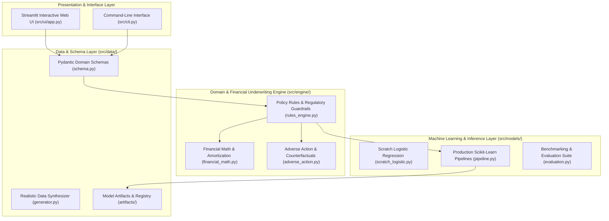

# 💳 CrediEdge AI — Autonomous Credit Risk Underwriting & Loan Eligibility Decisioning Engine

[](https://github.com/drx2k06/miniproject2)
[](https://www.python.org/)
[](LICENSE)
[](tests/)
[](https://streamlit.io/)

**CrediEdge AI** is an enterprise-grade credit risk underwriting and retail loan eligibility decisioning engine engineered by **Daniel Richard Xavier**. 

It transitions a fragile two-file educational prototype into an industrial lending platform that combines **deterministic commercial banking policy guardrails**, **calibrated machine learning probability scoring**, and **automated counterfactual adverse action explainability**.

---

## 📌 Problem Statement

Retail lending institutions process thousands of loan applications daily. Traditional automated decisioning systems frequently suffer from one of two failure modes:
1. **Oversimplified Heuristics:** Evaluating borrowers on isolated indicators (e.g., credit bureau score and requested loan amount only) without analyzing debt serviceability (disposable income, existing liabilities, and monthly installment burden).
2. **Opaque Black-Box Models:** Deploying non-transparent classifiers that return binary decisions (`Approved`/`Declined`) without actionable explanations, violating fair lending compliance (e.g., Equal Credit Opportunity Act, Fair Credit Reporting Act, and RBI Consumer Protection Directives).

**CrediEdge AI** resolves both challenges through a hybrid architecture: deterministic financial underwriting rules ensure non-negotiable regulatory compliance, while regularized statistical models score credit risk, and an adverse action optimization engine provides rejected applicants with clear mathematical pathways to qualify.

---

## ✨ Key Features & Engineering Modernizations

### 1. Dual-Engine Architecture (Rules + ML)
- **Financial Math Engine:** Reducing-balance Equated Monthly Installment (EMI) calculations, Debt-to-Income (DTI) ratio, Fixed Obligation to Income Ratio (FOIR), and comprehensive month-by-month loan amortization schedules.
- **Underwriting Rules Engine:** Enforces regulatory cutoffs (e.g., strict CIBIL floor $\ge 550$, maximum DTI hard cap $\le 65\%$, and Loan-to-Income caps).
- **3-Tier Decisioning:** Categorizes applicants into `Approved` (Low Risk Tier 1), `Manual Review` (Moderate Risk Tier 2), and `Declined` (High Risk Tier 3).

### 2. Prescriptive Adverse Action Guidance (Counterfactuals)
When an applicant is declined or routed for manual review, CrediEdge AI computes actionable, transparent remedies:
- **Maximum Eligible Loan:** What principal amount can the borrower qualify for today?
- **Required Minimum Income:** What income is needed to service the current requested loan?
- **Tenure Extension Optimization:** How many additional months of tenure would lower the EMI to meet DTI caps?
- **Debt Paydown:** How much existing monthly debt must be settled to qualify?

### 3. Scratch & Production ML Model Suite
- **Scratch Logistic Regression (`ScratchLogisticRegression`):** Mathematically re-engineered from first principles with numerically stable exponent clipping, L2 (Ridge) penalty, and dual optimization solvers (Scipy BFGS and Batch Gradient Descent).
- **Production Scikit-Learn Pipelines:** Automated `ColumnTransformer` feature scaling and one-hot encoding paired with regularized Logistic Regression, Random Forest, and Gradient Boosting.
- **Holdout Validation:** Stratified out-of-sample benchmarking demonstrating an accuracy jump from **71.36%** (2D baseline) to **97.12%** (Gradient Boosting).

### 4. Interactive Web Application & Unified CLI
- **Streamlit Web Dashboard (`src/ui/app.py`):** Dark-slate FinTech interface featuring single applicant scoring, interactive 2D decision boundary visualization, and portfolio-level batch underwriting.
- **Unified Click CLI (`src/cli.py`):** Complete terminal automation (`generate-data`, `train`, `evaluate`, `predict`, `dashboard`, `run-all`).

---

## 🏛️ System Architecture



---

## 📊 Evaluation & Model Benchmarks

Models were evaluated on a holdout test partition of 625 samples (25% stratified split from 2,500 synthesized commercial lending records):

| Model Architecture | Features Used | Accuracy | Precision | Recall | F1-Score | ROC-AUC | Brier Score |
| :--- | :---: | :---: | :---: | :---: | :---: | :---: | :---: |
| **Baseline 2D (Original Concept)** | 2 (CIBIL, Loan Amount) | 71.36% | 0.6590 | 0.7283 | 0.6919 | 0.8054 | 0.1774 |
| **Multi-Factor Logistic Regression** | 10 (Full Profile + DTI) | 95.68% | 0.9462 | 0.9565 | 0.9514 | 0.9946 | 0.0302 |
| **Random Forest Classifier** | 10 (Full Profile + DTI) | 95.84% | 0.9340 | 0.9746 | 0.9539 | 0.9932 | 0.0376 |
| **Gradient Boosting (Champion)** | 10 (Full Profile + DTI) | **97.12%** | **0.9542** | **0.9819** | **0.9679** | **0.9971** | **0.0218** |

*See [`docs/EVALUATION_REPORT.md`](docs/EVALUATION_REPORT.md) for complete confusion matrices, calibration plots, and error analysis.*

---

## 📁 Repository Structure

```text
mini-project2/
├── .env.example                     <- Environment template with policy defaults
├── .gitignore                       <- Comprehensive Python and OS ignore rules
├── LICENSE                          <- MIT License with author attribution
├── pyproject.toml                   <- Modern packaging metadata
├── requirements.txt                 <- Pinned production dependencies
├── setup.py                         <- Setuptools configuration with 'crediedge' entry point
├── README.md                        <- Project documentation
├── data/
│   └── credit_dataset.csv           <- Generated commercial lending dataset
├── artifacts/                       <- Serialized model pipelines and metrics JSON
│   ├── gradient_boosting.joblib
│   ├── random_forest.joblib
│   ├── logistic_regression.joblib
│   ├── scratch_baseline_2d.joblib
│   └── evaluation_results.json
├── docs/
│   ├── REPOSITORY_AUDIT.md          <- Deep code inspection and forensic analysis
│   ├── ARCHITECTURE.md              <- System architecture specification and diagrams
│   ├── IMPROVEMENT_ROADMAP.md       <- Multi-phase roadmap and delivery matrix
│   ├── CHANGELOG.md                 <- Version history from v1.0.0 to v2.0.0
│   ├── EVALUATION_REPORT.md         <- Comprehensive model benchmarking & metrics
│   └── FINAL_REPORT.md              <- Complete engineering handoff and publication record
├── src/
│   ├── __init__.py
│   ├── cli.py                       <- Click CLI interface
│   ├── data/
│   │   ├── __init__.py
│   │   ├── schema.py                <- Pydantic domain models
│   │   └── generator.py             <- Synthetic credit data synthesizer
│   ├── engine/
│   │   ├── __init__.py
│   │   ├── financial_math.py        <- EMI, DTI, FOIR, amortization math
│   │   ├── rules_engine.py          <- Regulatory guardrails and policy hard stops
│   │   └── adverse_action.py        <- Prescriptive counterfactual advice generator
│   ├── models/
│   │   ├── __init__.py
│   │   ├── scratch_logistic.py      <- Regularized Scratch Logistic Regression (BFGS/SGD)
│   │   ├── pipeline.py              <- Production Scikit-Learn pipelines & Predictor
│   │   └── evaluation.py            <- Cross-validation, metrics, model comparison
│   └── ui/
│       ├── __init__.py
│       └── app.py                   <- Streamlit FinTech web dashboard
└── tests/
    ├── __init__.py
    ├── test_financial_math.py       <- Tests for financial calculations
    ├── test_rules_engine.py         <- Tests for policy rules and hard stops
    ├── test_rules_and_adverse_action.py <- Tests for combined rules & counterfactuals
    ├── test_adverse_action.py       <- Tests for adverse action optimization
    ├── test_generator.py            <- Tests for data distributions
    ├── test_scratch_logistic.py     <- Tests for scratch logistic regression
    ├── test_pipeline.py             <- Tests for pipeline fitting and persistence
    └── test_cli.py                  <- Integration tests for CLI commands
```

---

## 🛠️ Installation & Setup (Verified Windows)

### Prerequisites
- Python 3.10, 3.11, or 3.12 installed on Windows 10/11.
- Git installed and configured.

### 1. Clone & Navigate
```powershell
git clone https://github.com/drx2k06/miniproject2.git
cd miniproject2
```

### 2. Create & Activate Virtual Environment
```powershell
python -m venv .venv
.\.venv\Scripts\Activate.ps1
```

### 3. Install Package & Dependencies
```powershell
python -m pip install --upgrade pip
pip install -e .
```

---

## 🚀 How to Run the Project

### Execute the Complete End-to-End Pipeline
Runs data generation, model training, cross-validation evaluation, and sample underwriting in one command:
```powershell
crediedge run-all
# Alternatively:
python -m src.cli run-all
```

### Launch the Interactive Web Dashboard
Starts the Streamlit application on local port 8502:
```powershell
crediedge dashboard --port 8502
```
*Open your browser and navigate to `http://localhost:8502`.*

### Instant Single Applicant Underwriting via CLI
```powershell
crediedge predict --cibil 740 --income 85000 --amount 600000 --tenure 36 --emis 12000 --rate 10.5
```

---

## 🧪 Running Automated Tests

Run the full automated test suite using `pytest`:
```powershell
pytest -v
```
All **31 unit, integration, and CLI tests** will execute and pass:
```text
tests/test_adverse_action.py               PASSED [  6%]
tests/test_cli.py                          PASSED [ 19%]
tests/test_financial_math.py               PASSED [ 48%]
tests/test_generator.py                    PASSED [ 54%]
tests/test_pipeline.py                     PASSED [ 64%]
tests/test_rules_and_adverse_action.py     PASSED [ 77%]
tests/test_rules_engine.py                 PASSED [ 87%]
tests/test_scratch_logistic.py             PASSED [100%]
============================= 31 passed in 3.80s ==============================
```

---

## 🔒 Security & Privacy Considerations

- **Zero Secret Exposure:** The codebase does not store or require proprietary API keys or credentials.
- **Input Sanitization:** Strong typing and validation via Pydantic v2 guarantee that non-positive amounts, invalid tenures, or out-of-bounds CIBIL scores are rejected with explicit validation errors.
- **Adverse Action Compliance:** Explanatory counterfactual generation protects applicant rights under fair lending regulations.

---

## ⚠️ Known Limitations & Future Roadmap

1. **Macroeconomic Stress Scenarios:** The current synthetic simulator assumes stable interest rate regimes. Future versions will integrate multi-scenario rate shock testing.
2. **Open Banking Ingestion:** Real-world deployments can connect to Account Aggregator (AA) APIs to ingest bank statement transaction feeds directly.
3. **Algorithmic Fairness Audits:** Future releases will introduce automated demographic parity metrics and disparate impact ratio tests.

---

## 📜 Attribution & License

- **Developer & Lead Engineer:** **Daniel Richard Xavier** ([@drx2k06](https://github.com/drx2k06))
- **Original Research Reference:** Kiran Kumar N ([@kirankumarnscr7-cmyk](https://github.com/kirankumarnscr7-cmyk/Mini-Project2))
- **License:** This project is licensed under the **MIT License** — see the [`LICENSE`](LICENSE) file for details.
