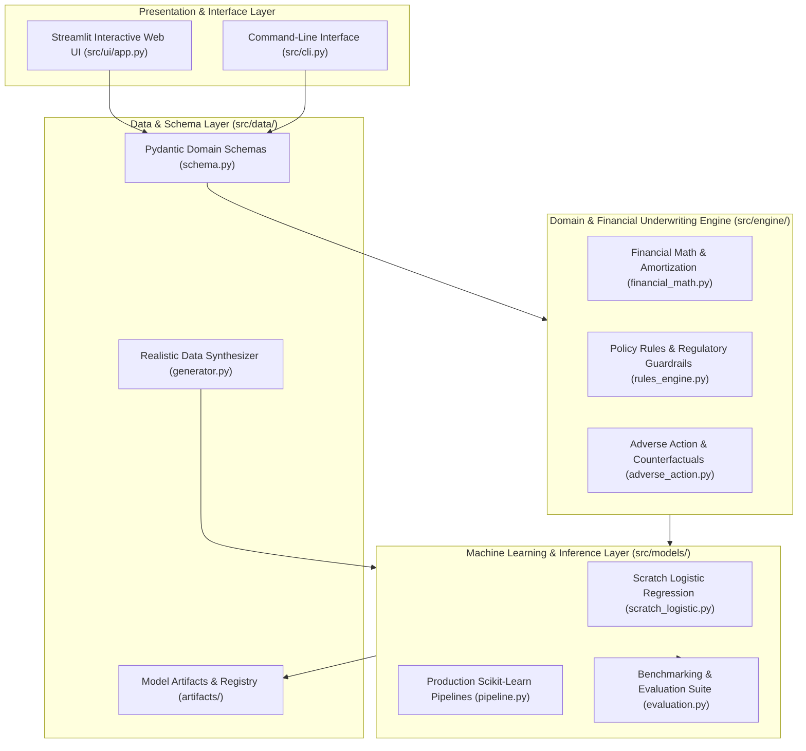

# CrediEdge AI — System Architecture & Design Specification

**Platform Name:** CrediEdge AI  
**Lead Architect & Developer:** Daniel Richard Xavier  
**Version:** 2.0.0  
**Target Environment:** Windows 11 / Cross-Platform Python 3.12+  

---

## 1. Architectural Vision & Core Principles

CrediEdge AI transforms the fragile 2-file prototype into an enterprise-grade credit risk underwriting and loan eligibility decisioning engine. The platform is designed around five core software engineering principles:

1. **Clean Separation of Concerns:** Domain logic (financial math, amortization, regulatory thresholds) is strictly decoupled from machine learning models, data ingestion, and presentation interfaces.
2. **Deterministic Governance with Probabilistic Modeling:** Machine learning predictions are wrapped in regulatory compliance and credit underwriting guardrails (e.g., maximum permissible DTI ratio, minimum CIBIL cutoff, FOIR thresholds).
3. **Actionable Explainability (Adverse Action & Counterfactuals):** In compliance with credit regulations, the engine does not merely return a binary decision; it delivers automated counterfactual recommendations advising rejected applicants on exact remedial actions to qualify.
4. **Reproducibility & Rigorous Evaluation:** Data pipelines utilize fixed seed generation, stratified splitting, cross-validation, and multi-metric benchmarking against baseline models.
5. **Production Readiness:** Full type safety via Pydantic v2, persistence via `joblib`, headless CLI automation, and a modern responsive interactive dashboard.

---

## 2. System Architecture Diagram

---

## 3. Detailed Component Decomposition

### 3.1. Data & Schema Layer (`src/data/`)
- **`schema.py`:** Defines strongly-typed Pydantic v2 schemas:
  - `ApplicantProfile`: Validates age (18–75), CIBIL score (300–900), monthly net income, requested loan amount, tenure (months), existing monthly EMIs, employment status (`Salaried`, `Self-Employed`, `Business`), and loan purpose (`Personal`, `Home`, `Auto`, `Education`).
  - `UnderwritingMetrics`: Computed Debt-to-Income (DTI), Fixed Obligation to Income Ratio (FOIR), and Monthly EMI.
  - `DecisionResult`: Status (`Approved`, `Manual Review`, `Declined`), default probability, risk tier, decision factors, and counterfactual advice.
- **`generator.py`:** Generates high-fidelity synthetic credit datasets (1,000–50,000 records) reflecting real-world banking correlations:
  - Income and loan amount distributions with realistic covariance.
  - Credit score distribution adhering to Indian CIBIL / Experian bell curves.
  - Non-linear default risk interactions incorporating DTI stress and employment stability.

### 3.2. Domain & Financial Engine (`src/engine/`)
- **`financial_math.py`:**
  - Standard reducing-balance EMI formula:
    $$E = P \cdot r \cdot \frac{(1+r)^n}{(1+r)^n - 1}$$
  - Debt-to-Income (DTI) calculation:
    $$\text{DTI} = \frac{\text{Existing EMIs} + \text{Proposed EMI}}{\text{Net Monthly Income}}$$
  - Fixed Obligation to Income Ratio (FOIR).
  - Complete amortization schedule generator (month, principal, interest, remaining balance).
- **`rules_engine.py`:**
  - Implements banking policy hard stops (e.g. CIBIL < 550 = immediate decline; DTI > 65% = policy violation).
  - Three-tier classification:
    - Tier 1: Auto-Approve (Low Risk, CIBIL $\ge$ 720, DTI $\le$ 45%).
    - Tier 2: Manual Underwriter Review (Moderate Risk, CIBIL 620–719 or DTI 45%–55%).
    - Tier 3: Decline (High Risk, CIBIL < 620 or DTI > 55%).
- **`adverse_action.py`:**
  - Counterfactual optimizer: Calculates the minimal adjustment required across loan amount, tenure, and existing liabilities to shift a declined application into the approval threshold.

### 3.3. Machine Learning & Inference Layer (`src/models/`)
- **`scratch_logistic.py`:**
  - Mathematically re-engineers the original `eligibilityy.py` concept with:
    - Numerically stable sigmoid: $\sigma(z) = \frac{1}{1 + e^{-\text{clip}(z, -500, 500)}}$.
    - Binary cross-entropy with L2 weight decay (Ridge regularization):
      $$J(\theta) = -\frac{1}{m}\sum_{i=1}^m \left[ y^{(i)}\ln(h_\theta(x^{(i)})) + (1-y^{(i)})\ln(1-h_\theta(x^{(i)})) \right] + \frac{\lambda}{2m}\|\theta_1:n\|^2$$
    - Dual optimization backends: Batch Gradient Descent with momentum and Scipy L-BFGS-B.
    - Full fit/predict/predict_proba interface adhering to Scikit-Learn estimator standards.
- **`pipeline.py`:**
  - Production Scikit-Learn pipelines combining `StandardScaler` for continuous features, `OneHotEncoder` for categorical features, and balanced `LogisticRegression` as well as `RandomForestClassifier`.
  - Model serialization to `artifacts/model_pipeline.joblib`.
- **`evaluation.py`:**
  - Metrics computation: Accuracy, Balanced Accuracy, Precision, Recall, F1-Score, ROC-AUC, Brier Calibration Score, and Confusion Matrix.
  - Generation of ROC curves, Precision-Recall curves, and 2D decision boundary meshgrids.

### 3.4. Presentation Layer (`src/ui/` & `src/cli.py`)
- **Interactive Streamlit Web Dashboard (`src/ui/app.py`):**
  - **Single Applicant Underwriting:** Real-time scoring, DTI gauges, risk tier badges, EMI amortization charts, and interactive counterfactual path-to-approval cards.
  - **Batch Underwriting Studio:** Drag-and-drop CSV processing, portfolio risk distribution charts, and exportable decision reports.
  - **Model Intelligence & Analytics:** Live decision boundary visualizer, ROC curves, calibration plots, and feature importance rankings.
- **Unified CLI (`src/cli.py`):**
  - `train`: Retrains models on synthetic or custom datasets and serializes artifacts.
  - `evaluate`: Runs cross-validation and generates evaluation reports.
  - `predict`: Instant CLI scoring for single applicants.
  - `batch`: Bulk-evaluates CSV application portfolios.

---

## 4. Security, Licensing, & Compliance

- **No Secrets or Credentials:** Fully self-contained, no external API keys required.
- **Adverse Action Transparency:** Complies with fair lending principles by providing clear explanatory rationale for all rejected profiles.
- **Input Validation:** Strict schema boundaries prevent numerical overflows, zero-division, and negative values.
